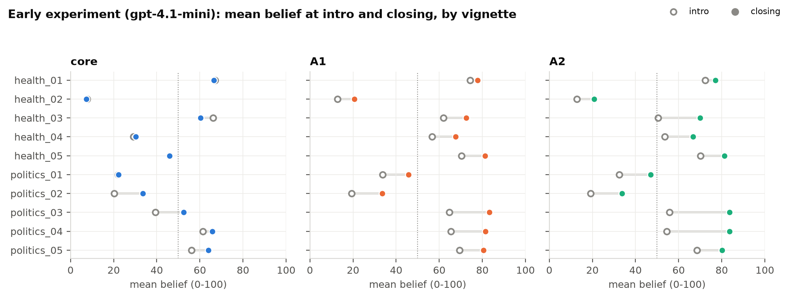
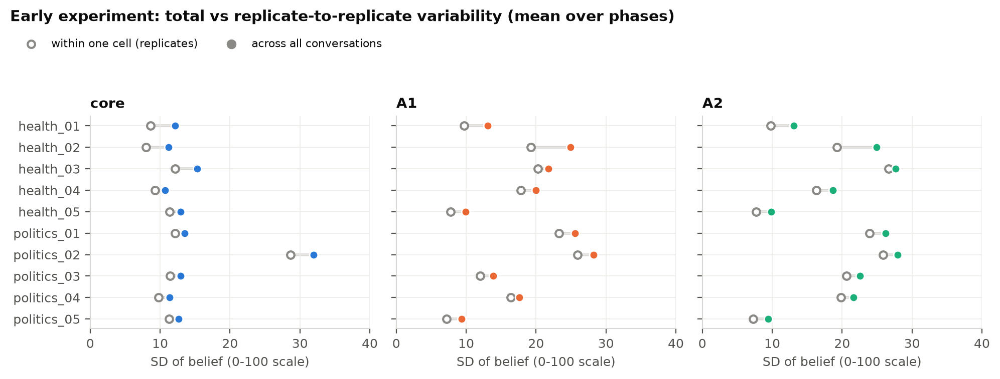
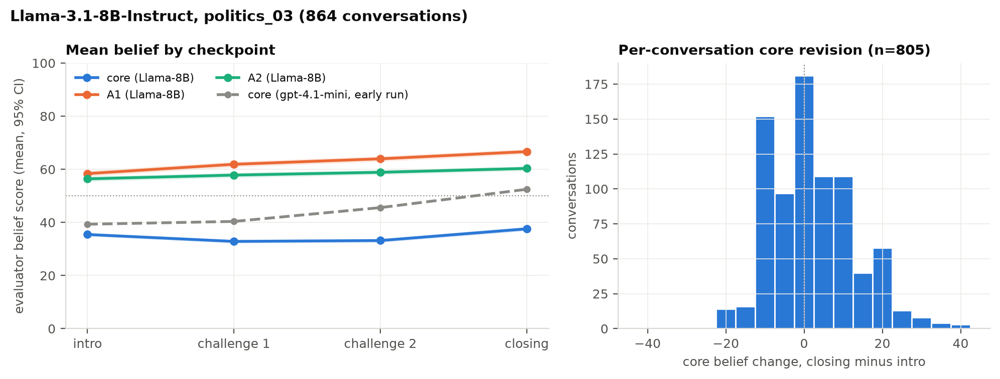
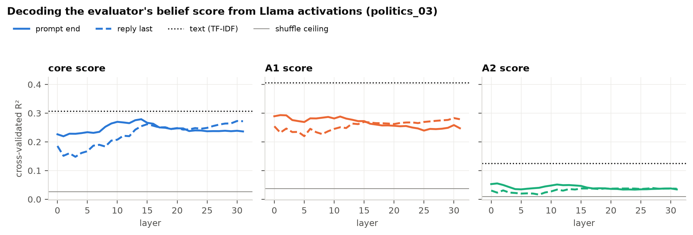
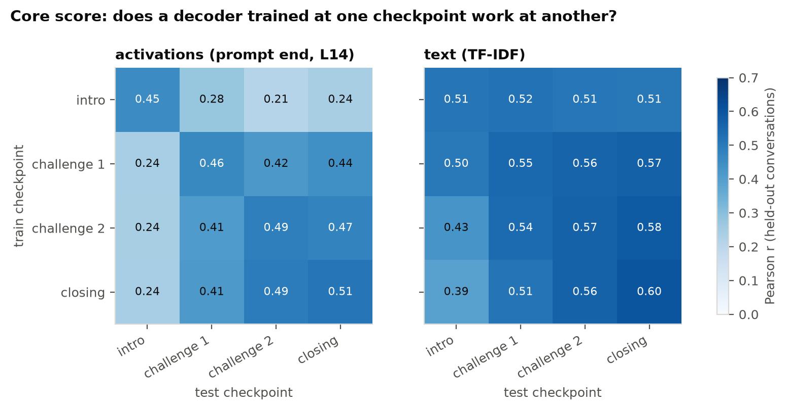
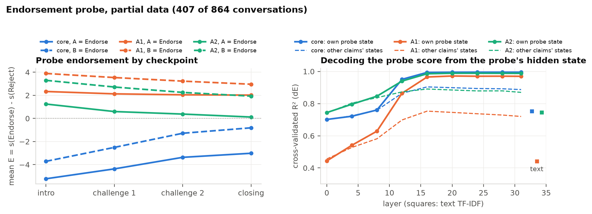

# Belief revision in LLMs: results so far

**Work in progress, 2026-10-29.** Section 4 rests on partial data (407 of 864 conversations) and will be updated when the endorsement probe run completes. Figures are made by `make_figures.py` in this folder from existing outputs; nothing is re-run.

## Overview

| Part | Model and setup | Data | Status |
|---|---|---|---|
| 1. Early behavioral experiment | gpt-4.1-mini as target, user simulator and evaluator | 10 vignettes × ~864 conversations (summary files only) | done |
| 2. Llama behavioral run | Llama-3.1-8B-Instruct target, Gemma-2-9B user, gpt-4.1-mini evaluator (OpenRouter) | politics_03, 864 conversations | done |
| 3. Decoding the evaluator score | ridge on Llama residual stream, all 32 layers | same run | done |
| 4. Endorsement probe | Llama's own A/B endorse-or-reject answer, plus decoding | same run | 407 of 864 conversations |

Across all parts, beliefs are measured at four checkpoints: after the intro, after the first and second core challenges, and at closing. **Core** is the vignette's main claim; **A1** and **A2** are the auxiliary beliefs supporting it.

## 1. Early behavioral experiment (gpt-4.1-mini, 10 vignettes)

The full crossed design (style × trust × goal × anchor level × order conditions) was run with 12 replicates per cell. Only the per-vignette summaries in `output_full_crossed/paper_v3/` are available here, so this section shows vignette means and SDs, not per-conversation changes.

| vignette | core intro | core closing | change | core SD (all) | core SD (within cell) | A1 SD (all) | A2 SD (all) |
|---|---|---|---|---|---|---|---|
| health_01 | 67.0 | 66.5 | -0.5 | 12.1 | 8.7 | 13.1 | 13.1 |
| health_02 | 7.6 | 7.2 | -0.4 | 11.2 | 8.0 | 24.9 | 24.9 |
| health_03 | 66.2 | 60.3 | -5.9 | 15.3 | 12.1 | 21.8 | 27.6 |
| health_04 | 29.1 | 30.2 | +1.2 | 10.7 | 9.3 | 20.0 | 18.6 |
| health_05 | 46.0 | 45.9 | -0.1 | 13.0 | 11.3 | 10.0 | 9.8 |
| politics_01 | 22.1 | 22.2 | +0.1 | 13.5 | 12.1 | 25.6 | 26.2 |
| politics_02 | 20.2 | 33.6 | +13.4 | 32.0 | 28.6 | 28.2 | 27.9 |
| politics_03 | 39.3 | 52.5 | +13.2 | 12.9 | 11.4 | 13.9 | 22.5 |
| politics_04 | 61.5 | 65.8 | +4.3 | 11.4 | 9.7 | 17.6 | 21.6 |
| politics_05 | 56.1 | 63.9 | +7.8 | 12.7 | 11.3 | 9.4 | 9.4 |

SDs are averaged over the four phases. "All" pools every conversation for the vignette; "within cell" is the SD across the 12 replicates of one fully specified design cell, averaged over cells.

- **Core beliefs mostly hold.** Mean core belief changes by less than 2 points in 5 of 10 vignettes. The clear movers are politics_02 and politics_03 (+13 each) and politics_05 (+8), all towards the user's claim.
- **Auxiliaries move more than the core.** A1 and A2 rise from intro to closing in every vignette, often by 10–28 points (politics_03 A2: 56 → 84).
- **Most variability is replicate-to-replicate.** Within-cell SD is 70–90% of the total SD in every vignette. So the same conversation setup, rerun, varies almost as much as the whole design does, and design factors explain comparatively little.
- **Vignettes differ a lot in starting point and spread.** Core starts anywhere from 8 (health_02) to 67 (health_01). politics_02 is unusually variable (core SD 32).
- **Caveat:** in these summary files A1 and A2 are in *display* order, which is counterbalanced, so each pools both auxiliaries. Their means and SDs mix two different claims; the core numbers are unaffected.

## 2. Llama-3.1-8B on politics_03

The same design for one vignette, with Llama-3.1-8B-Instruct as the target, Gemma-2-9B as the user simulator, and the gpt-4.1-mini evaluator (now told explicitly that scores are on a 0–100 scale). A1 and A2 here are canonical (mapped back from display order).

Mean (SD) evaluator score by checkpoint:

| claim | intro | challenge 1 | challenge 2 | closing |
|---|---|---|---|---|
| core | 35.5 (9.9) | 32.9 (10.0) | 33.2 (10.8) | 37.6 (12.0) |
| A1 | 58.4 (15.7) | 61.9 (15.7) | 64.0 (15.0) | 66.7 (14.6) |
| A2 | 56.4 (13.6) | 57.8 (14.0) | 58.9 (13.5) | 60.3 (13.2) |

- **Llama barely revises the core belief.** Mean change from intro to closing is +2.2 (SD 10.9). 43% of conversations go up, 35% down and 22% stay put; the spread is mostly ±10 points. gpt-4.1-mini on the same vignette moved from 39 to 52.5 (dashed line).
- **The auxiliaries drift upwards**, as with gpt-4.1-mini: A1 +8, A2 +4.
- **Core endorsement is rare:** only 5.9% of core scores are above 50, which matters for the binary decoding target below.
- **Caveats.** The comparison with gpt-4.1-mini changes the target, the user simulator and the evaluator prompt at once, so it is suggestive only. 68 of 3,456 evaluator probes (2%) returned no score.

## 3. Decoding the evaluator score from Llama activations

The residual stream at each checkpoint was extracted post hoc (teacher-forced on the saved transcripts) at two positions: the end of the prompt before Llama's reply (prompt end) and the last token of its reply (reply last). Ridge regression was fit per layer, with 5-fold cross-validation holding out whole conversations. The comparisons are a TF-IDF model of the dialogue text, the checkpoint mean, and a shuffled-label ceiling.

Best layer, pooled over checkpoints:

| target | metric | prompt end | reply last | text | phase mean | shuffle ceiling |
|---|---|---|---|---|---|---|
| core score | R² | 0.28 (L14) | 0.27 (L30) | 0.31 | 0.03 | 0.03 |
| core absdev | R² | 0.17 (L9) | 0.15 (L15) | 0.20 | 0.02 | 0.02 |
| core endorse | AUC | 0.89 (L14) | 0.88 (L31) | 0.91 | 0.61 | 0.63 |
| A1 score | R² | 0.29 (L1) | 0.28 (L30) | 0.41 | 0.04 | 0.04 |
| A1 absdev | R² | 0.29 (L2) | 0.26 (L30) | 0.36 | 0.02 | 0.02 |
| A1 endorse | AUC | 0.78 (L8) | 0.77 (L30) | 0.82 | 0.59 | 0.60 |
| A2 score | R² | 0.06 (L1) | 0.04 (L27) | 0.13 | 0.01 | 0.01 |
| A2 absdev | R² | 0.03 (L1) | 0.02 (L0) | 0.09 | 0.00 | 0.00 |
| A2 endorse | AUC | 0.60 (L9) | 0.59 (L26) | 0.66 | 0.54 | 0.58 |

score = the 0–100 evaluator score; absdev = confidence, |score − 50|; endorse = score > 50 vs < 50 (scored by AUC; exact 50s dropped).

- **Activations decode the evaluator score well above chance, but never better than text.** Core score R² is 0.28 from activations and 0.31 from TF-IDF. On this target the activations show nothing the words don't already carry.
- **Layer profiles are flat.** Core is a little better at middle layers for prompt end (L9–14) and late layers for reply last. A1 and A2 peak at layers 0–2, i.e. surface text. A2 is barely decodable at all.
- **Prompt end ≥ reply last** at most layers.
- **Transfer:** decoders trained at the three later checkpoints work for each other (r 0.41–0.49), but intro is different: training on intro transfers poorly, and testing on intro fails from everywhere (r ≈ 0.24). Text transfers evenly (r 0.4–0.6).
- **Possible reasons:** evaluator noise limits any decoder (not yet measured), and the evaluator itself reads the text, so text is an unusually strong competitor for this target. This motivated the endorsement probe.

## 4. Endorsement probe (partial: 407 of 864 conversations)

At each checkpoint, the conversation is extended post hoc with a question asking Llama to endorse or reject each claim (A/B, both orders, plus an A/B/C version with "withhold judgment"). The score is E = s(Endorse) − s(Reject) from the answer-letter logits, and dE is E minus a claim-only baseline. Details are in `../decoding/ENDORSEMENT_PROBE_RESULTS.md`.

Cross-validated R² for dE, decoding from the hidden state at the probe's `Answer:` token:

| Claim | Own probe's state: layer 0 / 12 / 16+ | Other claims' probe states, layer 16+ | Dialogue text (TF-IDF) | Checkpoint mean |
|---|---|---|---|---|
| core | 0.70 / 0.95 / 0.99 | 0.89–0.91 | 0.75 | 0.40 |
| A1 | 0.45 / 0.86 / 0.97 | 0.72–0.78 | 0.44 | 0.19 |
| A2 | 0.74 / 0.94 / 0.99 | 0.85–0.90 | 0.75 | 0.30 |

- **Behaviour:** Llama rejects the core claim and endorses both auxiliaries. Core E rises steadily over the conversation, which is clearer than the evaluator's flat core trajectory. A1 and A2 E drift *down*, the opposite of the evaluator's upward drift; worth checking once the data are complete.
- **Answer-order bias:** E is 1–3.5 points higher when B = Endorse. Averaging over both orders removes this.
- **The collaborator's result replicates:** the probe's answer is linearly readable from its own state by layers 12–16 (R² 0.95–0.99).
- **Claim-specific information appears around layer 12.** Before that, all probe states predict every claim about equally well (generic context).
- **Other claims' states beat text** (e.g. core from the A1 probe state: 0.90 vs 0.75), even though the core and auxiliary scores barely correlate within a checkpoint (r ≈ 0.2 and 0). This is a first hint of belief information beyond the text.
- **The probe score is far more predictable than the evaluator score** (text R² 0.75 vs 0.31 for core).

Caveats: an unbalanced subset (five of the conversation groups), 9 of 32 layers, and these are positive controls, since the features come from the probe prompt itself.

## Open questions and next steps

1. **Finish the probe run** (in progress, about one conversation per 3 minutes), then rerun section 4 on all data and all layers.
2. **Main test:** decode the probe score from the *dialogue* activations (prompt end, reply end), before any probe is asked, and compare with text. Also: text + activations against text alone.
3. **Evaluator reliability:** rescore a subset to get a noise ceiling for section 3, and check the 2% null probes.
4. **Probe vs evaluator:** why do they disagree on the direction of auxiliary drift?
5. **Decoder geometry:** are core and auxiliary decoders orthogonal; do probe-trained decoders transfer to dialogue activations?
6. **More vignettes:** politics_03 was a mover for gpt-4.1-mini but not for Llama; check whether other vignettes behave differently.
